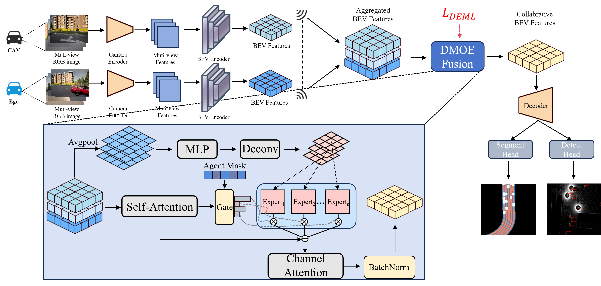

# CoBEVMoE
Heterogeneity-aware Feature Fusion with Dynamic Mixture-of-Experts for Collaborative Perception

## Framework


## Abstract
Collaborative perception aims to extend sensing coverage and improve perception accuracy by sharing information among multiple agents. 
However, due to differences in viewpoints and spatial positions, agents often acquire heterogeneous observations. Existing intermediate fusion methods primarily focus on aligning similar features, often overlooking the perceptual diversity among agents. To address this limitation, we propose \textbf{CoBEVMoE}, a novel collaborative perception framework that operates in the Bird’s Eye View (BEV) space and incorporates a Dynamic Mixture-of-Experts (DMoE) architecture. In DMoE, each expert is dynamically generated based on the input features of a specific agent, enabling it to extract distinctive and reliable cues while attending to shared semantics. This design allows the fusion process to explicitly model both feature similarity and heterogeneity across agents. Furthermore, we introduce a Dynamic Expert Metric Loss (DEML) to enhance inter-expert diversity and improve the discriminability of the fused representation. Extensive experiments on the OPV2V and DAIR-V2X-C datasets demonstrate that CoBEVMoE achieves state-of-the-art performance. Specifically, it improves the IoU for Camera-based BEV segmentation by ${+}1.5\%$ on OPV2V and the AP@50 for LiDAR-based 3D object detection by ${+}3.0\%$ on DAIR-V2X-C, verifying the effectiveness of expert-based heterogeneous feature modeling in multi-agent collaborative perception.

## <div align="center">**Data Preparation**</div>
1. Download OPV2V origin data and structure it as required. See [OpenCOOD data tutorial](https://opencood.readthedocs.io/en/latest/md_files/data_intro.html) for more detailed insructions.
2. After organize the data folders, download the `additional.zip` from [this url](https://ucla.app.box.com/v/UCLA-MobilityLab-OPV2V/file/1621920078208). This file contains BEV semantic segmentation labels that origin OPV2V data does not include.
3. The `additional` folder has the same structure of original OPV2V dataset. So unzip `additional.zip` and merge them with original opv2v data.
4. Remove scenario `opv2v/train/2021_09_09_13_20_58`, as this scenario has some bug for camera data.
## <div align="center">**Installation**</div>

```bash
# Clone repo
git clone https://github.com/godk0509/CoBEVMoE.git

cd CoBEVMoE/opv2v

# Setup conda environment
conda create -y --name cobevmoe python=3.7
conda activate cobevmoe

# Install dependencies

python opencood/utils/setup.py build_ext --inplace
python setup.py develop
```

## <div align="center">**Training**</div>
OpenCOOD uses yaml file to configure all the parameters for training. To train your own model
from scratch or a continued checkpoint **on a single gpu**, run the following commonds:
```python
python opencood/tools/train_camera.py --hypes_yaml ${CONFIG_FILE} [--model_dir  ${CHECKPOINT_FOLDER}]
```
Arguments Explanation:
- `hypes_yaml`: the path of the training configuration file, e.g. `opencood/hypes_yaml/opcamera/cobevmoe.yaml`.
- `model_dir` (optional) : the path of the checkpoints. This is used to fine-tune the trained models. When the `model_dir` is
given, the trainer will discard the `hypes_yaml` and load the `config.yaml` in the checkpoint folder.

## <div align="center">**Inference**</div>
Please run the following command for dynamic BEV map segmentation 
```python
python opencood/tools/inference_camera.py --model_dir ${CHECKPOINT_FOLDER}
```
Please run the following command for static BEV map segmentation (road+lane)
```python
python opencood/tools/inference_camera.py --model_dir ${CHECKPOINT_FOLDER} --model_type static
```


## Demo


[点此下载高清 Demo (MP4)](demo_open.mp4)
